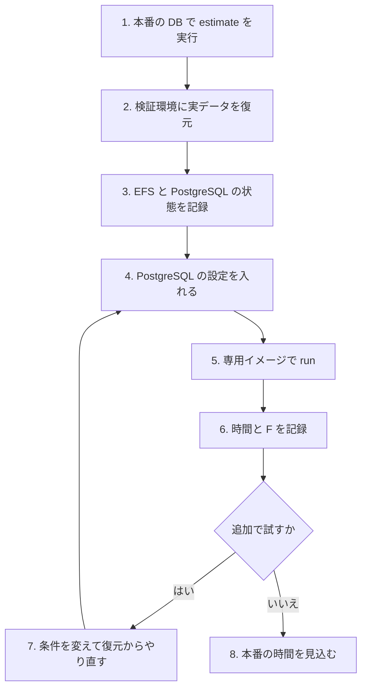
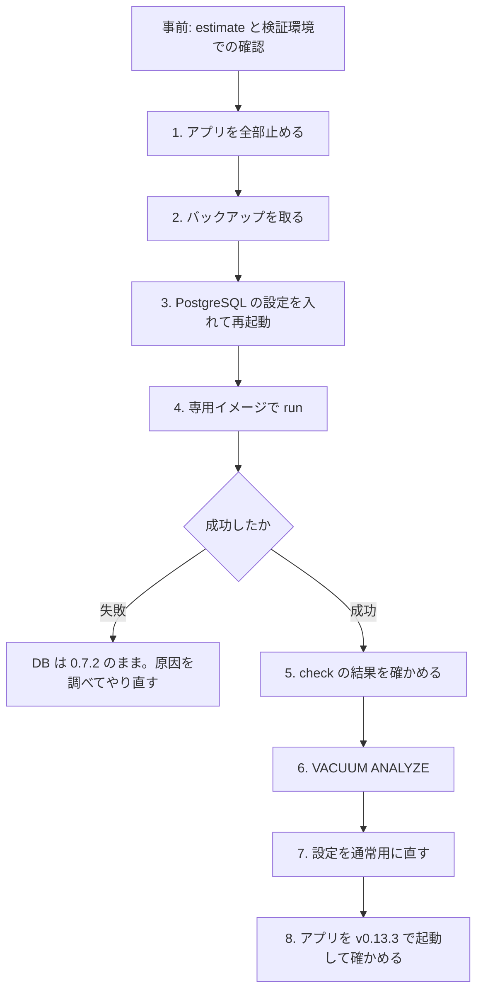

# Open WebUI 0.7.2 → v0.13.3 マイグレーション高速化 報告書

作成: 2026-11-16　／　計測: 2026-11-14〜16　／　ブランチ: `perf/migration-speedup`

この文書だけで、(1) 何が分かったか、(2) 検証環境（実データ・EFS）で何をどう試すか、(3) 本番でどう実行するか、(4) 時間をどう見込むか、が分かるようにまとめた。計測の生の表は `RESULTS.md` にある。

## 目次

1. 結論
2. 対象と前提
3. 遅い原因
4. 効いた対策
5. 試して効かなかったもの、取り下げた仮説
6. 時間の見込みの式と、推奨するメモリ
7. 進捗の表示
8. マイグレーション専用イメージ
9. 検証環境（実データ・EFS）で試す手順
10. 本番で実行する手順
11. 未解決の点と注意
12. 置き場所の一覧

---

## 1. 結論

| 項目                               | 内容                                                                                                                                                                                                                                                                                           |
| ---------------------------------- | ---------------------------------------------------------------------------------------------------------------------------------------------------------------------------------------------------------------------------------------------------------------------------------------------- |
| 遅い原因                           | 0.7.2 → 0.8.0 の間にある `8452d01d26d7`（チャットの JSON をメッセージ 1 件ずつの表 `chat_message` に展開する）が、43 本の時間の 8 割以上を占める。インデックス 8 本と外部キーを保ったまま 1 行ずつ挿入するので、データがメモリに載らなくなると、ディスクのあちこちを読み書きして極端に遅くなる |
| 対策 1: PostgreSQL の設定          | コードを変えずに約 4 倍（10 万件で 3,864 → 976 秒）。効くのは共有バッファ（`shared_buffers`）と、チェックポイントの間隔（`max_wal_size`・`checkpoint_timeout`）                                                                                                                                |
| 対策 2: マイグレーションの書き換え | さらに約 2.2 倍（976 → 437 秒）。規模が大きいほど効く（100 万件では、途中の版 15,694 秒 → 最終版 7,490 秒）                                                                                                                                                                                    |
| 合わせた効果                       | 10 万件（chat テーブル 6.1 GB）で **3,864 秒 → 437 秒（約 9 倍）**。100 万件（61 GB）は **約 2 時間 5 分**（この Mac での値）                                                                                                                                                                  |
| 結果の正しさ                       | 書き換えた版の結果（`chat_message`、`chat.current_message_id`、`shared_chat`、`access_grant`）は、本体の元の版と 1 行ずつ一致することを確認した                                                                                                                                                |
| 時間の見込み                       | 式を作った（6 章）。chat テーブルの大きさ・共有チャットの行数・PostgreSQL のメモリから計算する。**ただし実行する環境とこの Mac の速さの比（F）が未知**で、検証環境で 1 回動かして求める必要がある                                                                                              |
| 進捗                               | 実行中に「何件中何件、残り約何分」を 30 秒ごとに表示するようにした（7 章）                                                                                                                                                                                                                     |
| 実行の仕方                         | マイグレーション専用の Docker イメージを用意した（8 章）。アプリを起動せずに、見積もり・実行・監視・確認ができる                                                                                                                                                                               |
| 本体への還元                       | 本体は頼まれていないコードの PR を受け付けない方針。計測結果を添えて Discussion か Issue に出す形になる                                                                                                                                                                                        |

---

## 2. 対象と前提

### 対象

- 0.7.2 の最後のマイグレーション `c440947495f3` から、v0.13.3 の最後 `9f6c2a8d1b43` までの **43 本**。
- 本番は、43 本を **1 つのトランザクション**で実行する（アプリの起動時に走る）。途中で失敗するか止めると、0.7.2 の状態に戻る。

### 想定する環境

PostgreSQL 15 を Docker で動かし、データをネットワークストレージ（EFS など）に置いていて、チャットの量が多くメモリに載りきらない環境。

### 計測の環境

| 項目         | 内容                                                                                                                      |
| ------------ | ------------------------------------------------------------------------------------------------------------------------- |
| マシン       | Mac mini、OrbStack（Docker）。データは外付け SSD                                                                          |
| PostgreSQL   | 15.20（`postgres:15`）。16 でも測り、差がないことを確認した                                                               |
| 基準の設定   | `shared_buffers=3GB`、`max_wal_size=16GB`、`checkpoint_timeout=30min`、`maintenance_work_mem=1GB`、コンテナのメモリ 12 GB |
| ダミーデータ | 本物の 0.7.2 を動かして作った行と突き合わせて合わせた（下の表）                                                           |
| 規模         | 1 万件（0.6 GB）、10 万件（6.1 GB）、30 万件（18.3 GB）、100 万件（61 GB、メッセージ 1,909 万件）                         |

ダミーデータを実物に合わせた点（合っていないと計測の意味がないため、3 回作り直した）:

| 点         | 内容                                                                                                                             |
| ---------- | -------------------------------------------------------------------------------------------------------------------------------- |
| 文字の形式 | 0.7.2 は日本語を `\uXXXX` の形で保存する（1 文字 6 バイト）。最初は UTF-8 のまま入れていて、大きさが実物と違った                 |
| 項目       | `lastSentence`、`followUps`、`annotation`、`feedbackId`、`meta.tags`、`models`、`statusHistory` などを実物に合わせた             |
| 文章       | 同じ文の繰り返しでは圧縮が効きすぎる。リポジトリの日本語の翻訳ファイルと変更履歴から取った自然な文章を使った（日本語 8：英語 2） |
| 大きさ     | チャット 1 件は平均 19 メッセージ、保存後 約 62 KB、展開後 約 205 KB（圧縮率 約 3.35）                                           |

**実データとの違いが残る点**: メッセージの長さ、1 チャットあたりのメッセージ数、巨大なチャットの有無、共有チャットの割合。これらは `estimate`（8 章）で実データから測れる。

---

## 3. 遅い原因

43 本のうち、時間がかかるのは 5 本だけ。残り 38 本は合わせて 30 秒以下。

| マイグレーション | 内容                                           | 本体の元の版で遅い理由                                                                                                                    |
| ---------------- | ---------------------------------------------- | ----------------------------------------------------------------------------------------------------------------------------------------- |
| `8452d01d26d7`   | チャットの JSON を `chat_message` に展開する   | 主キー・インデックス 7 本・外部キーを付けたまま挿入する。インデックスがメモリに載らなくなると、1 行ごとにディスクのあちこちを読み書きする |
| `9a1b2c3d4e5f`   | 各チャットの「表示中のメッセージ」を決めて書く | 全チャットの JSON をもう一度読み、候補を `chat_message` から 1 件ずつ探す                                                                 |
| `c1d2e3f4a5b6`   | 共有チャットを別の表に移す                     | 共有チャットを JSON ごと Python に読み込む。さらに `chat_message` を全部読んで 0 行を消す後片付けがある                                   |
| `d4c1a8e37b62`   | `chat` にインデックスを作る                    | 表を読み通す（コードは変えていない）                                                                                                      |
| `b7c8d9e0f1a2`   | `chat` の全行を更新する                        | 全行の書き換え（コードは変えていない）                                                                                                    |

既定の設定（共有バッファ 128 MB、`max_wal_size` 1 GB）で特に遅くなるのは、次の 2 つが重なるため。

- 共有バッファが小さく、インデックスのページが載らない。
- チェックポイントが頻繁に起き、そのたびにページ全体を WAL に書き直す（10 万件で WAL が 7.2 GB。設定を変えると 5.3 GB）。

---

## 4. 効いた対策

### 4.1 PostgreSQL の設定（コードを変えない）

10 万件、本体の元の版:

| 設定                                 | 合計（秒） | `8452` | `9a1b` |
| ------------------------------------ | ---------- | ------ | ------ |
| 既定のまま                           | 3,864      | 3,168  | 464    |
| 基準の設定（共有バッファ 3 GB など） | 976        | 488    | 353    |
| 共有バッファ 8 GB                    | 650        | 400    | 185    |

推奨する設定:

| 設定                   | 値                                  | 理由                                                                                           |
| ---------------------- | ----------------------------------- | ---------------------------------------------------------------------------------------------- |
| `shared_buffers`       | コンテナのメモリの 25%（最低 1 GB） | 最も効く。下の表を参照                                                                         |
| `max_wal_size`         | 16GB                                | チェックポイントの回数を減らす                                                                 |
| `checkpoint_timeout`   | 30min                               | 同上                                                                                           |
| `maintenance_work_mem` | 1GB                                 | インデックス作成の並べ替え用。10 万件では差が出なかったが、大きい規模で不利にならない値        |
| コンテナの `shm_size`  | 1g 以上                             | インデックスの並列作成が `/dev/shm` を使う。Docker の既定（64 MB）では足りなくなるおそれがある |

共有バッファの効き方（最終版、10 万件、コンテナのメモリ 12 GB）:

| 共有バッファ | 256 MB | 512 MB | 1 GB | 3 GB | 8 GB |
| ------------ | ------ | ------ | ---- | ---- | ---- |
| 合計（秒）   | 638    | 562    | 567  | 437  | 404  |

コンテナのメモリそのものの効き方（最終版、10 万件、共有バッファはその 25%）:

| コンテナのメモリ | 600 MB | 1.2 GB | 2.4 GB | 4.8 GB | 12 GB |
| ---------------- | ------ | ------ | ------ | ------ | ----- |
| 合計（秒）       | 899    | 745    | 785    | 694    | 437   |

共有バッファを 25% より大きくしても、OS のキャッシュが減るだけで得は小さい。**メモリを増やす効果が大きいのは、移行後のデータ（chat テーブルの約 1.66 倍）がメモリに載るかどうかの境目**。

### 4.2 マイグレーションの書き換え（5 つ）

| #   | 書き換え                                                                                               | 対象           | 効果                                                                                                                     |
| --- | ------------------------------------------------------------------------------------------------------ | -------------- | ------------------------------------------------------------------------------------------------------------------------ |
| 1   | インデックス 7 本と外部キーを、挿入の後でまとめて作る                                                  | `8452`         | 10 万件で 976 → 856 秒                                                                                                   |
| 2   | JSON をエスケープせずに書く（日本語を UTF-8 のまま保存。アプリが書く形式と同じ）                       | `8452`         | 書く量が減る。3 と合わせて 856 → 479 秒                                                                                  |
| 3   | 表示中のメッセージを `8452` の中で決め、補助の表で `9a1b` に渡す（全チャットの読み直しをやめる）       | `8452`・`9a1b` | `9a1b` が 353 → 4 秒                                                                                                     |
| 4   | 主キーも挿入の後で作る。重複した ID があれば、作る前に取り除く（先に入った行を残す＝元の版と同じ結果） | `8452`         | 100 万件で 15,694 → 7,710 秒。規模が大きいほど効く                                                                       |
| 5   | 共有チャットを DB の中で移す。`chat_message` を全部読む後片付けを、外部キーの連鎖削除があるときは省く  | `c1d2`         | 30 万件で 83 → 33 秒（本番と同じ方式）。全体への効果は 1〜2%。価値は、共有チャットを Python のメモリに読み込まなくなる点 |

補助の表（`migration_chat_current_message_hint`）は、チャット 1 件につき 1 行（チャットの ID と、表示中のメッセージの ID）。`8452` が作り、`9a1b` が使って消す。Python のメモリには 5,000 行ずつしか持たない。

### 4.3 結果（43 本の合計、秒）

| 規模（chat テーブル） | 既定の設定・元の版 | 基準の設定・元の版 | 1 を入れた版 | 1〜3 を入れた版 | 1〜4（最終版） | 1〜5        |
| --------------------- | ------------------ | ------------------ | ------------ | --------------- | -------------- | ----------- |
| 10 万件（6.1 GB）     | 3,864              | 976                | 856          | 479             | 437            | 516（ぶれ） |
| 30 万件（18.3 GB）    | —                  | —                  | —            | —               | 1,818          | 1,811       |
| 100 万件（61.0 GB）   | —                  | —                  | —            | 15,694          | 7,710          | 7,490       |

同じ条件でも 10〜20% ぶれる。

### 4.4 結果が同じであることの確認

`verify.sh` で、基準の版と書き換えた版をそれぞれ実行し、`compare_dbs.py` で 1 行ずつ突き合わせた。

| データ                                                  | 内容                                                                                     | 結果 |
| ------------------------------------------------------- | ---------------------------------------------------------------------------------------- | ---- |
| 壊れた形のデータ（`make_edge_fixture.py`、22 チャット） | 重複した ID、`history` が配列、`done` が文字列、タイムスタンプが異常、共有チャット、など | 一致 |
| 本物の 0.7.2 で作ったデータ                             | 実際の画面操作で作ったチャット                                                           | 一致 |
| ダミーデータ 1 万件                                     | メッセージ 19 万件                                                                       | 一致 |

JSON の列は、書き方（エスケープの有無）が違うので、意味で比較している（`COMPARE_SEMANTIC=1`）。

---

## 5. 試して効かなかったもの、取り下げた仮説

### 5.1 試して効かなかったもの

| 試したこと                                                                       | 期待                       | 結果                                                                                 | 判断                                                                                 |
| -------------------------------------------------------------------------------- | -------------------------- | ------------------------------------------------------------------------------------ | ------------------------------------------------------------------------------------ |
| `wal_buffers` を 16 MB〜256 MB に変える                                          | WAL の書き込みが速くなる   | 差はぶれの範囲                                                                       | 既定でよい                                                                           |
| `maintenance_work_mem` を 64 MB〜2 GB に変える（10 万件）                        | インデックス作成が速くなる | 差はぶれの範囲                                                                       | 1 GB にしておく（害はない）                                                          |
| `wal_level=minimal`（同じトランザクションで作った表への書き込みは WAL を省ける） | WAL が減って速くなる       | WAL は 4.8 GB → 0.3 GB に減ったが、時間は 856 → 802 秒でぶれの範囲                   | この Mac では WAL の量は律速ではない。**EFS では効く可能性が残る**（9 章で試す候補） |
| TOAST の圧縮を `lz4` にする（`default_toast_compression=lz4`）                   | 圧縮が速くなる             | 479 → 502 秒、976 → 924 秒。ぶれの範囲                                               | 効かない                                                                             |
| JSON の展開を SQL に置き換える（Python を通さない）                              | 行の往復がなくなる         | 結果は一致したが **4〜20 倍遅い**。`json` 型は `->` のたびに文書全体を解析し直すため | 不採用（ブランチ `perf/migration-sql-backfill-experiment` に残してある）             |
| PostgreSQL 16 にする                                                             | 新しい版のほうが速い       | 15 と差なし                                                                          | 本番と同じ 15 で測った                                                               |
| 共有バッファを 25% より大きくする（12 GB 中 8 GB）                               | さらに速くなる             | 437 → 404 秒（ぶれの範囲に近い）                                                     | 25% で十分                                                                           |
| 共有チャットの書き換え（4.2 の 5）で全体を縮める                                 | 100 万件で 15% 縮む        | 本番と同じ方式では 1〜2%                                                             | 入れてあるが、時間の効果は小さい                                                     |

### 5.2 取り下げた仮説（途中で報告し、後で訂正したもの）

| 仮説                                                                   | 実際                                                                                                              |
| ---------------------------------------------------------------------- | ----------------------------------------------------------------------------------------------------------------- |
| 律速は WAL の量である                                                  | `wal_level=minimal` で WAL をほぼなくしても速くならなかった                                                       |
| 律速は圧縮（pglz）である                                               | `lz4` にしても変わらなかった                                                                                      |
| SQL だけで展開すれば速い                                               | 4〜20 倍遅かった                                                                                                  |
| 共有バッファを小さくすれば「データがメモリに載らない」状況を再現できる | OS のキャッシュが肩代わりするので再現できない。コンテナのメモリ上限（`docker update --memory`）で絞る必要があった |
| 主キーのインデックスが WAL を膨らませている                            | WAL の量は件数に比例していた。遅いのは、インデックスへのばらばらな読み書き                                        |
| `c1d2` は 100 万件で全体の 15% を占める                                | 計測の方式（1 本ずつ確定）が作った見かけ。本番の方式では 30 万件で 4.5%                                           |
| `c1d2` を直したら `d4c1` が延びた                                      | 同上。本番の方式では延びない（52 → 53 秒）                                                                        |

最後の 2 つの理由: 計測では 1 本ごとの時間を出すために 1 本ずつ確定していた。確定の直後に `chat_message` を最初に読む処理が、行ごとの「確定済み」の印を付ける書き込みを引き受けて、重く見える。本番（1 つのトランザクション）では、その書き込みはマイグレーションの間は起きず、**移行後に最初に読むとき**に起きる（10 章の手順 8 で対処する）。合計の時間は、方式によらず同じだった（30 万件で 1,818 秒と 1,837 秒）。

### 5.3 計測の進め方での失敗

| 失敗                                                                                             | 対処                                                              |
| ------------------------------------------------------------------------------------------------ | ----------------------------------------------------------------- |
| ダミーデータの形式が実物と違っていた（3 回）                                                     | 本物の 0.7.2 を動かして行を突き合わせ、圧縮率まで確認してから測る |
| 計測中に、計測が読むファイルを編集した                                                           | 編集は別の作業ツリーで行う                                        |
| `docker restart` の既定（10 秒）で PostgreSQL が強制終了され、次の起動で復旧に最大 20 分かかった | `-t 600` 以上を付ける。**本番でも同じ注意が要る**                 |
| 計測中に別のコンテナやディスクを読む処理を動かした                                               | 計測中はほかの処理を止める。影響した回は捨てて測り直す            |
| PostgreSQL のプロセスが終了コード 2 で終了した（2 回。設定の変更・再起動・DB の複製の直後）      | 原因は不明。3 回目は起きていない                                  |

---

## 6. 時間の見込みの式と、推奨するメモリ

### 6.1 式（最終版のコード、43 本の合計、この Mac での秒）

    S   = chat テーブルの大きさ（GB）   … SELECT pg_total_relation_size('chat') / 1024.0^3
    N   = 共有チャットの行数            … SELECT count(*) FROM chat WHERE user_id LIKE 'shared-%'
    RAM = PostgreSQL のコンテナが使えるメモリ（GB）

    r = RAM ÷ (1.66 × S)          … 0.05〜1.2 の範囲に丸める
    時間（秒） = S × (70 − 17.5 × ln r) ＋ N × k        k = 0.03（r ≥ 1 のとき）、0.11（r < 1 のとき）

    本番の時間 = 上の値 × F        F = 本番の環境とこの Mac の速さの比（検証環境で求める。9 章）

- 行数ではなく**テーブルの大きさ**を使うのは、時間が「読み書きするバイト数」で決まるため。行数は同じでも、メッセージが長ければ時間は延びる。
- 1.66 は、移行後の DB の大きさ ÷ chat テーブルの大きさ（100 万件で 101 GB ÷ 61 GB）。r は「移行後のデータがメモリに載る割合」に当たる。
- 実測との誤差: 規模の 3 点（10 万・30 万・100 万件）で 5% 以内、メモリを絞った 4 点で 12% 以内。
- 前提: メッセージ 1 件あたり chat テーブル上で約 3.2 KB。これより小さい（短いメッセージが多い）と、インデックス作成の比重が増えて、式より遅くなる方向にずれる。

### 6.2 早見表（F = 1、共有チャットは全体の 1% とした場合）

| chat テーブル         | メモリ 8 GB  | 16 GB        | 32 GB        | 64 GB        | 128 GB       |
| --------------------- | ------------ | ------------ | ------------ | ------------ | ------------ |
| 6 GB（10 万件相当）   | 9 分         | 7 分         | 7 分         | 7 分         | 7 分         |
| 18 GB（30 万件相当）  | 34 分        | 30 分        | 23 分        | 22 分        | 22 分        |
| 61 GB（100 万件相当） | 2 時間 15 分 | 2 時間 2 分  | 1 時間 50 分 | 1 時間 38 分 | 1 時間 13 分 |
| 200 GB                | 7 時間 48 分 | 7 時間 48 分 | 7 時間 10 分 | 6 時間 29 分 | 5 時間 49 分 |

実測は 12 GB のメモリで、61 GB が 7,490〜7,710 秒（約 2 時間 5 分）。200 GB の行は、測った範囲（61 GB まで）の外への当てはめで、メモリが S の 8% 未満の領域は式の下限に丸めている。
`estimate`（8 章）が、実際の S と N からこの表を出す。

### 6.3 推奨するメモリ

| 項目                                     | 推奨                                                             | 根拠                                                                                                      |
| ---------------------------------------- | ---------------------------------------------------------------- | --------------------------------------------------------------------------------------------------------- |
| PostgreSQL のコンテナのメモリ            | できれば S × 2 以上。無理なら、取れるだけ                        | r ≥ 1（メモリ ≥ 1.66 × S）で速い領域に入る。それ未満でも、メモリを 2 倍にするごとに S × 12 秒ずつ縮む     |
| `shared_buffers`（共有バッファ）         | コンテナのメモリの 25%（最低 1 GB）                              | 4.1 の表。25% を超えても得は小さい                                                                        |
| コンテナの `shm_size`                    | 1g 以上                                                          | インデックスの並列作成用                                                                                  |
| 移行するプロセス（専用イメージ）のメモリ | 2 GB 以上。巨大なチャットがあれば、その展開後の大きさ × 6 を足す | チャットを 1,000 件ずつ読む。平均 205 KB なら約 600 MB。`estimate` が、最大のチャットの大きさと目安を出す |

### 6.4 必要なディスクと、EFS での下限

| 項目             | 量                                                                                                      |
| ---------------- | ------------------------------------------------------------------------------------------------------- |
| 移行後に増える量 | S × 0.66（`chat_message` とインデックス）。100 万件で 61 → 101 GB                                       |
| WAL              | 書く総量は S × 0.69（100 万件で 42 GB、30 万件で 12.7 GB）。同時に持つのは最大 `max_wal_size`（16 GB）  |
| 読む量           | S（chat テーブルを 1 回読み通す）。メモリに載らなければ、インデックス作成で `chat_message` をさらに読む |

EFS のスループットで決まる**時間の下限**（これより速くはならない、という目安）:

    下限（秒） = (S ＋ 0.66 × S ＋ 0.69 × S) × 1024 ÷ T        T = EFS のスループット（MiB/秒）

| chat テーブル | 100 MiB/秒   | 20 MiB/秒    | 5 MiB/秒    | 1 MiB/秒 |
| ------------- | ------------ | ------------ | ----------- | -------- |
| 61 GB         | 24 分        | 2 時間 2 分  | 8 時間 9 分 | 41 時間  |
| 200 GB        | 1 時間 20 分 | 6 時間 41 分 | 27 時間     | 134 時間 |

EFS のバースト方式では、基準のスループットは「保存量 1 GiB あたり 50 KiB/秒」（100 GiB で約 5 MiB/秒）で、クレジットがある間だけ速くなる（要確認: 実際の方式と残高）。**クレジットが尽きると、上の表の右側になる。**

---

## 7. 進捗の表示

`8452d01d26d7` が、実行中に次のように表示する（Alembic のログと同じ場所。アプリの起動ログ、または専用イメージの出力）。

    INFO  [alembic.runtime.migration] Running upgrade 374d2f66af06 -> 8452d01d26d7, Add chat_message table
    INFO  [alembic.runtime.migration] chat_message backfill: 1,000,000 chats to go through; progress is reported every 30 seconds
    INFO  [alembic.runtime.migration] chat_message backfill: 120,400 of 1,000,000 chats (12.0%), 2,298,112 messages, 10m05s elapsed, about 1h13m left for the backfill (the indexes are built after it)
    ...
    INFO  [alembic.runtime.migration] chat_message backfill: finished 1,000,000 chats, 19,091,128 messages in 1h24m; building the indexes next
    INFO  [alembic.runtime.migration] chat_message: step 1 of 9: primary key ...
    INFO  [alembic.runtime.migration] chat_message: step 1 of 9: primary key done in 6m12s
    INFO  [alembic.runtime.migration] chat_message: step 2 of 9: index ix_chat_message_chat_id ...
    ...
    INFO  [alembic.runtime.migration] chat_message: step 9 of 9: foreign key to chat done in 2m40s
    INFO  [alembic.runtime.migration] chat_message: all done in 1h42m (backfill 1h24m)

（数字は例。）

| 段階                       | 分かること                                                                                |
| -------------------------- | ----------------------------------------------------------------------------------------- |
| 展開（backfill）           | 何件中何件、経過、残りの見込み。**最初の数分で、展開にかかる時間が分かる**                |
| インデックス作成（9 段階） | いま何段階目か、1 段階にかかった時間。段階の中の進み具合は `monitor`（8 章）で見える      |
| 残りの 42 本               | Alembic の `Running upgrade A -> B` の行。時間がかかるのは `c1d2`、`d4c1`、`9a1b`、`b7c8` |

全体の見込みの立て方: **展開の時間 ÷ 0.75 ≒ 43 本の合計**。10 万件・メモリ 12 GB の実測では、展開 370 秒、インデックス作成 54 秒、残りの 42 本 約 55 秒で、合計 483 秒（展開は 77%）。規模が大きくメモリが足りないほど、インデックス作成と残りの比重が増える（100 万件では `8452` 以外が約 2 割、`8452` の中のインデックス作成の割合は未計測）。

10 万件を専用イメージで動かしたときの実際の出力（抜粋）:

    03:59:39 INFO  [alembic.runtime.migration] chat_message backfill: 100,000 chats to go through; progress is reported every 30 seconds
    04:00:10 INFO  [alembic.runtime.migration] chat_message backfill: 7,100 of 100,000 chats (7.1%), 133,122 messages, 30s elapsed, about 6m35s left for the backfill (the indexes are built after it)
    04:02:45 INFO  [alembic.runtime.migration] chat_message backfill: 54,900 of 100,000 chats (54.9%), 1,040,459 messages, 3m05s elapsed, about 2m32s left for the backfill (the indexes are built after it)
    04:05:50 INFO  [alembic.runtime.migration] chat_message backfill: finished 100,000 chats, 1,906,644 messages in 6m10s; building the indexes next
    04:06:14 INFO  [alembic.runtime.migration] chat_message: step 1 of 9: primary key done in 24s
    04:06:44 INFO  [alembic.runtime.migration] chat_message: all done in 7m04s (backfill 6m10s)
    04:07:29 完了。かかった時間: 8 分 2 秒（483 秒）

最初の 30 秒の見込み（残り 6 分 35 秒）に対して、実際の残りは 5 分 40 秒だった。見込みは、進むにつれて正確になる。

元の本体の版にも進捗の行（5 万件ごと）はあったが、Alembic の設定で INFO が捨てられる名前のロガーに出していたため、**実際には表示されていなかった**。

---

## 8. マイグレーション専用イメージ

公式の `ghcr.io/open-webui/open-webui:v0.13.3` に、書き換えたマイグレーション 3 本と、実行用の道具（`migrate_tool.py`）を重ねたもの。アプリは起動しない。

### できあがったもの

x86 用（`linux/amd64`）を Docker Hub に置いてある。

    docker pull notfolder/owui-migrate:0.13.3-amd64

以下の例の `owui-migrate:0.13.3` は、これに読み替える。

### 作り方（自分で作る場合）

    bench/migration/image/build.sh owui-migrate:0.13.3 linux/amd64

- 2 つ目の引数はプラットフォーム。省くと、作るマシンと同じになる（この Mac では arm64）。**本番が x86 のサーバーなら `linux/amd64` を指定する。**
- 元にするイメージを変えるとき: `BASE_IMAGE=<イメージ> bench/migration/image/build.sh ...`（v0.13.3 以外では、3 本のファイルが本体で変わっていないかを先に確かめる）。
- 本番へ運ぶ方法: レジストリ（ECR など）に push するか、`docker save owui-migrate:0.13.3 | gzip > owui-migrate.tar.gz` で固めて運び、`docker load` する。

### 使い方

接続先は、アプリと同じ `DATABASE_URL` で渡す。

| 命令                            | 内容                                                                                                                       | DB への変更      |
| ------------------------------- | -------------------------------------------------------------------------------------------------------------------------- | ---------------- |
| `estimate [--ram GB]`           | 大きさ・件数・抜き取り（約 2,000 件）・大きいチャット上位 5 件を調べ、時間の見込み、推奨する設定、必要なディスクを表示する | なし（読むだけ） |
| `run [--yes] [--ram GB]`        | マイグレーションを実行する。進捗を時刻つきで表示し、終わったら、かかった時間・速さの比 F・確認の結果を表示する             | あり             |
| `monitor [--every 秒] [--once]` | 実行中に別の端末から見る。DB の大きさの増え方、実行中の接続、インデックス作成の進み具合                                    | なし             |
| `check`                         | 終わったあとの確認（位置、件数、表示中のメッセージ、インデックス、外部キー、補助の表が残っていないか）                     | なし             |

    # 見積もり（アプリが動いていても実行できる。チャットを約 2,000 件読む）
    docker run --rm --network <DB と同じネットワーク> -e DATABASE_URL=postgresql://<ユーザー>:<パスワード>@db:5432/<DB 名> \
        owui-migrate:0.13.3 estimate --ram 32

    # 実行（端末が切れても止まらないよう、背景で動かしてログを追う）
    docker run -d --name owui-migrate --network <ネットワーク> -e TZ=Asia/Tokyo -e DATABASE_URL=... owui-migrate:0.13.3 run --yes --ram 32
    docker logs -f owui-migrate

    # 監視（別の端末）
    docker run --rm --network <ネットワーク> -e DATABASE_URL=... owui-migrate:0.13.3 monitor

`--ram` に PostgreSQL のコンテナのメモリを渡すと、終わったときに、その条件での速さの比 F を表示する。元のイメージの死活確認（アプリの応答を見るもの）は外してある。

表示する時刻はコンテナの時刻（既定は UTC）。日本時間で見るには `-e TZ=Asia/Tokyo` を付ける。

`run` は、アプリの起動時と同じ入口（設定の読み込みの中でマイグレーションが走る処理）を、アプリを起動せずに通す。`DATABASE_URL` 以外にアプリが DB 接続に使う環境変数（`DATABASE_SCHEMA` など）があれば、同じものを渡す。

---

## 9. 検証環境（実データ・EFS）で試す手順

目的は 3 つ: **(a) 速さの比 F を求める、(b) 実データで問題が出ないことを確かめる、(c) 本番の時間を見込む。**

### 手順

| #   | やること                                                                                      | 記録するもの                                                                                                      |
| --- | --------------------------------------------------------------------------------------------- | ----------------------------------------------------------------------------------------------------------------- |
| 1   | 本番の DB に対して `estimate` を実行する（読むだけ。アプリは動いたままでよい）                | S、N、チャットの件数、メッセージ 1 件あたりの大きさ、圧縮率、大きいチャット上位 5 件、いまの設定、PostgreSQL の版 |
| 2   | 検証環境に実データを復元する（`pg_dump -Fc` → `pg_restore`、または EFS のバックアップから）   | 復元にかかった時間（EFS の書き込みの速さの目安になる）。復元後に `VACUUM ANALYZE`                                 |
| 3   | EFS と環境の状態を記録する（下の表）                                                          | スループットのモード、クレジットの残高、保存量、PostgreSQL のコンテナのメモリ上限                                 |
| 4   | PostgreSQL の設定を入れて再起動する（`estimate` が出す `ALTER SYSTEM` 文。`shm_size` も）     | `SHOW shared_buffers` などで、入ったことを確かめる                                                                |
| 5   | 専用イメージで `run --yes` を実行する。別の端末で `monitor`                                   | ログ全体（`docker logs owui-migrate > run.log`）                                                                  |
| 6   | 終わったら、`run` の最後に出る「かかった時間」と「F」を記録する                               | 合計の秒数、F、展開の時間、インデックス作成の各段階の時間、EFS のクレジットの減り方                               |
| 7   | 余裕があれば、条件を変えてやり直す（下の「追加で試す候補」）。毎回、手順 2 の復元からやり直す | 同上                                                                                                              |
| 8   | 本番の時間 = 式の値（本番の S・N・メモリ）× F                                                 | —                                                                                                                 |

**全部を待たなくてよい。** 展開の進捗の行が出始めたら、「残り約何分」から展開の時間が分かり、÷ 0.7 で全体の見込みが立つ。そこで止めても（`docker rm -f owui-migrate`）、1 つのトランザクションなので 0.7.2 の状態に戻る。ただし F を正確に出すには、最後まで動かすのがよい（インデックス作成の比重が、この Mac と違う可能性があるため）。

### 手順 3 で記録する EFS と環境の項目

| 項目                                                                                                        | 見る場所                                                 | 何に使うか                                                         |
| ----------------------------------------------------------------------------------------------------------- | -------------------------------------------------------- | ------------------------------------------------------------------ |
| スループットのモード（バースト / エラスティック / プロビジョンド）                                          | EFS のコンソール、または `aws efs describe-file-systems` | 6.4 の下限の T を決める                                            |
| クレジットの残高（`BurstCreditBalance`）                                                                    | CloudWatch                                               | 実行の前後で記録する。減った量 ÷ 時間 が、実際に使ったスループット |
| 許可されているスループット（`PermittedThroughput`）、実際の入出力（`MeteredIOBytes` または `TotalIOBytes`） | CloudWatch                                               | 実行中に上限に張り付いていれば、EFS が律速                         |
| 保存量                                                                                                      | EFS のコンソール                                         | バースト方式の基準のスループット（1 GiB あたり 50 KiB/秒）を出す   |
| 性能モード（汎用 / 最大 I/O）、マウントのオプション                                                         | コンソール、`mount` の出力                               | 小さな書き込みの遅さに効く                                         |
| PostgreSQL のコンテナのメモリ上限、ホストのメモリ                                                           | `docker stats`、`docker inspect`                         | 式の RAM                                                           |
| 本番と検証環境で、上の項目が同じかどうか                                                                    | —                                                        | 違えば、F はそのまま使えない                                       |

### 追加で試す候補（優先の順）

| #   | 試すこと                                                                 | 理由                                                                                         | この Mac での結果                         |
| --- | ------------------------------------------------------------------------ | -------------------------------------------------------------------------------------------- | ----------------------------------------- |
| 1   | 推奨の設定＋最終版（基本の 1 回）                                        | F を求める                                                                                   | —                                         |
| 2   | `wal_level=minimal`＋`max_wal_senders=0`                                 | WAL の書き込み（S × 0.69）をほぼなくせる。EFS のように書き込みが遅い場所では効く可能性がある | 効果なし（SSD では WAL は律速でなかった） |
| 3   | PostgreSQL のメモリを増やす（S × 2 以上）                                | 速い領域に入るかの確認                                                                       | 10 万件で 694 → 437 秒                    |
| 4   | 本体の元の版（公式イメージのまま）＋推奨の設定を、進捗が読めるところまで | 書き換えの効果を実データで確かめる。本体への報告の材料になる                                 | 100 万件で 2 倍以上の差                   |
| 5   | 既定の設定＋本体の元の版を、短時間だけ                                   | 既定の設定での遅さの確認                                                                     | 10 万件で 3,864 秒                        |

2 を本番で使う場合の注意: レプリケーションや WAL のアーカイブを使っている環境では使えない。使っていなければ、移行の間だけ設定し、終わったら戻す。

### 実データで結果が同じかを確かめる（任意）

検証環境に復元した DB の小さな写し（または全体）で、公式の v0.13.3 のイメージと専用イメージをそれぞれ実行し、`compare_dbs.py` で突き合わせる。手順は `verify.sh` を参照（この Mac の計測用の構成が前提なので、接続先を書き換えて使う）。

---

## 10. 本番で実行する手順

前提: Docker Compose で、アプリと PostgreSQL（`db`）を動かしている。構成が違う場合（ECS など）は、「アプリを止める」「専用イメージを 1 回だけ動かす」を、その仕組みの方法に読み替える。

| #    | 手順                                                                                        | 命令の例                                                                                                                                       | 注意                                                                                                                                                                                       |
| ---- | ------------------------------------------------------------------------------------------- | ---------------------------------------------------------------------------------------------------------------------------------------------- | ------------------------------------------------------------------------------------------------------------------------------------------------------------------------------------------ |
| 事前 | `estimate` で時間とディスクを見込み、作業の時間枠を決める                                   | 8 章                                                                                                                                           | 時間 = 式 × F。F が未確定なら、余裕を大きく取る                                                                                                                                            |
| 1    | アプリをすべて止める（複数台あれば全部）                                                    | `docker compose stop open-webui`                                                                                                               | 動いたままだと、マイグレーションがロックを待って進まない。新しい版のアプリが先に起動すると、アプリ側がマイグレーションを始めてしまう                                                       |
| 2    | バックアップを取る                                                                          | `docker compose exec db pg_dump -U <ユーザー> -Fc <DB 名> > backup.dump`、または PostgreSQL を止めて EFS のバックアップ                        | 取れたことを確かめる。大きな DB では `pg_dump` 自体に時間がかかる                                                                                                                          |
| 3    | PostgreSQL の設定を入れ、`shm_size: 1g` を足して、作り直して起動する                        | `estimate` が出す `ALTER SYSTEM` 文 → `docker compose stop -t 900 db` → `docker compose up -d db`                                              | **止めるときは `-t 900` を付ける**（既定の 10 秒では強制終了になり、次の起動で復旧に時間がかかる）。`SHOW shared_buffers` で確かめる                                                       |
| 4    | 専用イメージで実行する                                                                      | `docker run -d --name owui-migrate --network <ネットワーク> -e DATABASE_URL=... owui-migrate:0.13.3 run --yes` → `docker logs -f owui-migrate` | 別の端末で `monitor`。**途中で止めると、最初からやり直しになる**（0.7.2 の状態に戻る）                                                                                                     |
| 5    | 最後に出る「確認」が「問題なし」であることを確かめる                                        | `docker logs owui-migrate \| tail -20`                                                                                                         | ログを保存する（`docker logs owui-migrate > migrate.log`）                                                                                                                                 |
| 6    | `VACUUM ANALYZE` を実行する                                                                 | `docker compose exec db psql -U <ユーザー> -d <DB 名> -c "VACUUM (ANALYZE, VERBOSE) chat_message" -c "VACUUM (ANALYZE) chat"`                  | 1 つのトランザクションで入れた行は、最初に読まれるときに「確定済み」の印を書き込む。先に済ませておかないと、**利用者の最初の操作が遅くなる**。時間は未計測（100 万件で 15 分前後の見込み） |
| 7    | 設定を通常の運用の値にする                                                                  | `shared_buffers` は 25% のままが望ましい。`max_wal_size` などは残してもよい                                                                    | 既定に戻すなら `ALTER SYSTEM RESET ALL` のあと再起動（`-t 900`）                                                                                                                           |
| 8    | アプリを公式の v0.13.3 のイメージで起動し、ログイン・チャットの表示・共有チャットを確かめる | `docker compose up -d open-webui`                                                                                                              | マイグレーションは済んでいるので、アプリは何もせずに起動する。専用イメージと公式イメージの違いは、マイグレーションの 3 本だけ                                                              |

### 失敗したとき

| 状況                                 | DB の状態                                      | 対処                                                                                                    |
| ------------------------------------ | ---------------------------------------------- | ------------------------------------------------------------------------------------------------------- |
| 実行中にエラー、または止めた         | 0.7.2 のまま（自動で戻る）                     | ログで原因を確かめ、直してから手順 4 をやり直す。アプリを 0.7.2 で起動すれば、元のとおり使える          |
| PostgreSQL が落ちた                  | 起動し直すと復旧処理が走り、0.7.2 の状態に戻る | 復旧を待つ（`max_wal_size` が大きいと、復旧に時間がかかる）。原因（メモリ不足、ディスク不足）を確かめる |
| 完了したが、アプリで問題が見つかった | v0.13.3 の状態                                 | 手順 2 のバックアップから戻す                                                                           |

### 止まる原因になりうるもの（事前に確かめる）

| 項目         | 確かめること                                                                                                                                      |
| ------------ | ------------------------------------------------------------------------------------------------------------------------------------------------- |
| ディスク     | いまより S × 0.66 ＋ 16 GB 多く使える（EFS は容量の上限はないが、費用とスループットに効く）                                                       |
| タイムアウト | PostgreSQL の `statement_timeout`、`idle_in_transaction_session_timeout` が 0。接続の途中にプーラーやロードバランサーがあれば、通さずに直接つなぐ |
| メモリ       | PostgreSQL のコンテナ、専用イメージのコンテナとも、上限で殺されない（6.3）                                                                        |
| ほかの接続   | アプリ、バッチ、監視などが DB の表をつかんでいない（`run` が、ほかの接続があれば注意を出す）                                                      |
| 版           | 0.7.2 から直接 v0.13.3 へ。途中の版を経由していない（`run` が、0.7.2 でなければ注意を出す）                                                       |

---

## 11. 未解決の点と注意

| 項目                                  | 状態                                                                                                                                                                                                                      |
| ------------------------------------- | ------------------------------------------------------------------------------------------------------------------------------------------------------------------------------------------------------------------------- |
| 速さの比 F                            | 未知。9 章の手順で求める。**本番の時間の見込みは、これが決まるまで出せない**                                                                                                                                              |
| 実行する環境の実数                    | S、N、メモリ、ストレージの設定。`estimate` と 9 章の表で集める                                                                                                                                                            |
| 専用イメージ                          | arm64 用を作り、10 万件の写しで `estimate`・`run`・`monitor`・`check` が動くことを確かめた（483 秒。式の値 437 秒に対して F = 1.11）。x86 用（`linux/amd64`）は同じ手順で作ったが、x86 のサーバーでの実行は確かめていない |
| `VACUUM` にかかる時間                 | 未計測（10 章の手順 6）                                                                                                                                                                                                   |
| メッセージが短いデータ                | 式の前提（1 件 3.2 KB）より小さいと、式より遅い方向にずれる。どれだけずれるかは未計測                                                                                                                                     |
| 巨大なチャット                        | 1,000 件ずつ読むので、数十 MB のチャットが多いと、移行するプロセスのメモリが増える。`estimate` で上位を確かめ、必要なら `yield_per` を減らす（`8452` の中の 1 か所）                                                      |
| PostgreSQL の異常終了（終了コード 2） | 計測中に 2 回。原因は不明。再現していない                                                                                                                                                                                 |
| 補助の表                              | `8452` と `9a1b` の 2 本をまたぐ。間で失敗しても、1 つのトランザクションなので残らない。`9a1b` は、表がなければ元の処理で動く                                                                                             |
| SQLite                                | 書き換えは PostgreSQL 向け。SQLite は、インデックスを後から作る点以外は元の動きのまま。SQLite での計測はしていない                                                                                                        |
| 本体への還元                          | 本体は頼まれていないコードの PR を受け付けない。同じ問題の報告（Issue #23273、#23134）は閉じられている。実績を添えて Discussion か Issue に出す形になる                                                                   |

---

## 12. 置き場所の一覧

| もの                       | 場所                                                                                                                                                                             |
| -------------------------- | -------------------------------------------------------------------------------------------------------------------------------------------------------------------------------- |
| 書き換えたマイグレーション | `backend/open_webui/migrations/versions/` の `8452d01d26d7_add_chat_message_table.py`、`9a1b2c3d4e5f_add_current_message_id_to_chat.py`、`c1d2e3f4a5b6_add_shared_chat_table.py` |
| 専用イメージ               | `bench/migration/image/`（`Dockerfile`、`build.sh`、`migrate_tool.py`）                                                                                                          |
| この報告書                 | `bench/migration/REPORT.md`                                                                                                                                                      |
| 計測の生の表               | `bench/migration/RESULTS.md`                                                                                                                                                     |
| 計測の道具の使い方         | `bench/migration/README.md`                                                                                                                                                      |
| ダミーデータを作る         | `bench/migration/gen_dummy.py`                                                                                                                                                   |
| 測る                       | `bench/migration/run.sh`（`--single-transaction` で本番と同じ方式）、`run_matrix.sh`（設定を変えながら繰り返す）                                                                 |
| 結果が同じかを確かめる     | `bench/migration/verify.sh`、`compare_dbs.py`、`make_edge_fixture.py`                                                                                                            |
| 不採用にした SQL 版        | ブランチ `perf/migration-sql-backfill-experiment`                                                                                                                                |

ブランチと版:

| 版                                      | コミット                        |
| --------------------------------------- | ------------------------------- |
| 本体の元の版（v0.13.3）                 | `b0e6098e9`                     |
| インデックスを後から作る                | `3f9dccd95`                     |
| ＋ エスケープせずに書く、読み直さない   | `b62e9a5a1`                     |
| ＋ 主キーを後から作る（最終版）         | `9f04cf639`                     |
| ＋ 共有チャット                         | `6d22148d7`                     |
| ＋ 進捗の表示、専用イメージ、この報告書 | `perf/migration-speedup` の先頭 |
